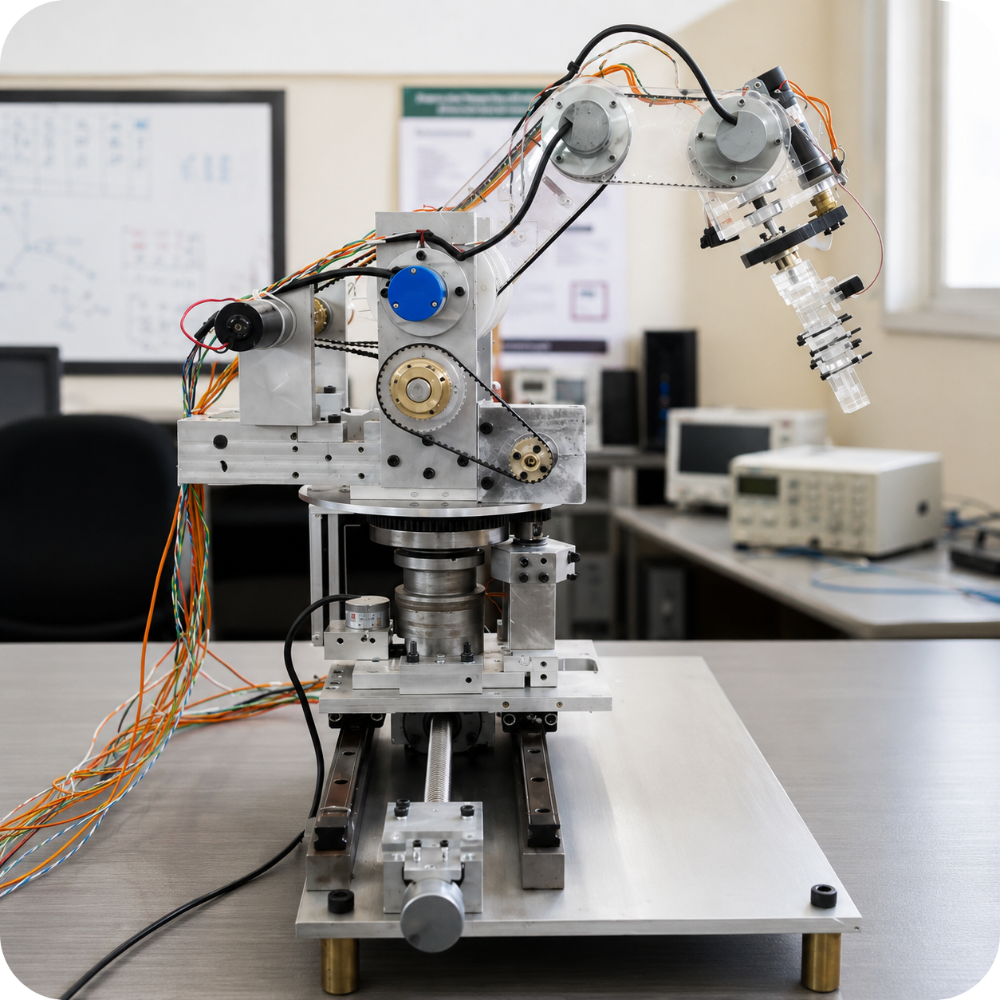

# PIEAS Robotic Arm: Embedded Control and ROS 2 Simulation

This project started as my final year BS Electrical Engineering thesis at PIEAS in 2024. Our team worked on supervised teleoperation of a six-DOF manipulator using STM32 controllers, encoder feedback and CAN communication. My work now continues with the same arm model in ROS 2, Gazebo and MoveIt, with a focus on motion planning, perception and pick-and-place tasks.

The reason for this extension is simple: I want to connect robotics algorithms with a working system and study their behaviour through repeatable experiments before moving to hardware.

Supervisor for the original thesis: Dr. Nasir Rehman Jadoon.

## Project development

The simulation workspace develops through five stages. The orchard experiment extends the same arm into a separate application alongside conveyor sorting.

| Stage | Work and purpose | Documentation |
| --- | --- | --- |
| 1. Robot model and Gazebo | Recover the original geometry and joint chain, then establish a model that loads and reports joint states. | [Robot description](robotics_lab/src/pieas_arm_description/README.md) |
| 2. Joint control | Connect timed joint commands to simulated motion and compare the command with feedback. | [Control experiments](robotics_lab/src/pieas_arm_control/README.md) |
| 3. Motion planning | Add collision checking, joint-space planning, inverse kinematics and tool-position tasks. | [MoveIt integration](robotics_lab/src/pieas_arm_moveit_config/README.md) |
| 4. Factory sorting | Use RGB-D and LiDAR measurements to classify parts, choose a bin and run a pick-and-place sequence. | [Conveyor sorting cell](robotics_lab/src/pieas_sorting/README.md) |
| 5. Apple harvesting | Detect partially visible apples, plan around a trellis and sort fruit by simulated appearance. | [Orchard workcell](robotics_lab/src/pieas_orchard/README.md) |

The simulated chain contains one linear rail joint and five rotary joints. The original gripper is a rigid model; opening and closing its fingers is a separate development task.

## Current work

Basic joint motion, MoveIt planning and a three-leg tool-position sequence have been exercised in Gazebo. A six-object sorting batch also completed locally with the simulation suction tool. These are simulation results, not a claim of hardware-ready autonomous operation.

The current factory launch has since been changed to display the original gripper. The sorting application still uses suction pickup assumptions, so that combination is not yet a working finger-grasping system. My next step is to preserve the suction mode and add a selectable original-gripper mode with finger joints, control and grasp verification. The factory sensors remain fixed overhead. The separate orchard package adds a camera and LiDAR on a mast attached to the fixed robot base. Its [validation record](robotics_lab/src/pieas_orchard/docs/VALIDATION.md) separates implemented features from verified runtime results.

[Progress and results](robotics_lab/EXPERIMENTS.md) · [Planned improvements](robotics_lab/docs/ROADMAP.md)

## Working with the repository

The simulation targets Ubuntu 24.04, ROS 2 Jazzy and Gazebo Harmonic. The [workspace overview](robotics_lab/README.md) explains the packages, and the [setup guide](robotics_lab/START_HERE.md) covers installation and launch commands. The [code reading guide](robotics_lab/docs/CODE_GUIDE.md) explains the file types and the order in which the code runs.

## Original hardware project

The arm has 6 joints, and each joint is driven by its own DC motor controlled by a dedicated STM32F103C8T6 microcontroller. A separate STM32 acts as the master controller, computes the inverse kinematics for a given target position, and sends the required joint angles (as encoder counts) to each joint controller over CAN bus. Each slave controller then closes its own position control loop using encoder feedback and drives the motor through an IBT-2 driver until it reaches the target.

Limit switches (mechanical on the prismatic joint, optical U-shaped sensors on the revolute joints) cut motor power if a joint reaches the edge of its safe range, so the arm doesn't over-extend or damage itself.

## Architecture

- 1x STM32 as master controller (Nucleo-F767ZI used for kinematics-heavy development/testing)
- 6x STM32F103C8T6 as slave controllers, one per joint
- CAN bus (via MCP2551 transceivers) for master-slave communication
- IBT-2 motor drivers + DC motors + rotary encoders per joint
- Limit switches for joint safety cutoffs
- FreeRTOS on the master controller for task scheduling (mutexes/semaphores for safe shared-resource access during real-time computation)

## Kinematics

Forward and inverse kinematics were derived using standard Denavit-Hartenberg parameters for the arm's link geometry, then implemented in MATLAB and verified against a CoppeliaSim (V-REP) simulation before being ported into the embedded firmware. Given a set of joint angles, forward kinematics gave the same end-effector pose in both MATLAB and simulation, and inverse kinematics was checked the same way, feeding target poses in and confirming the computed joint angles matched.

## Motor control

Each joint uses a closed-loop PID position controller based on encoder feedback. Motion profiles (trapezoidal velocity and cubic polynomial with time slicing) were used to keep joint motion smooth instead of commanding abrupt position jumps.

## Tools used

- STM32CubeMX + Keil uVision for firmware
- FreeRTOS
- MATLAB for kinematics derivation and verification
- SolidWorks for the mechanical CAD model
- CoppeliaSim (V-REP) for simulation and validation before hardware testing

##  Thesis Report  

The complete thesis is available here:  [**6DOF_Control – Full PDF Report**](./6DOF_Robotic_Manipulator_Thesis.pdf)

## Notes

This was a team project completed as a BS thesis at PIEAS.

