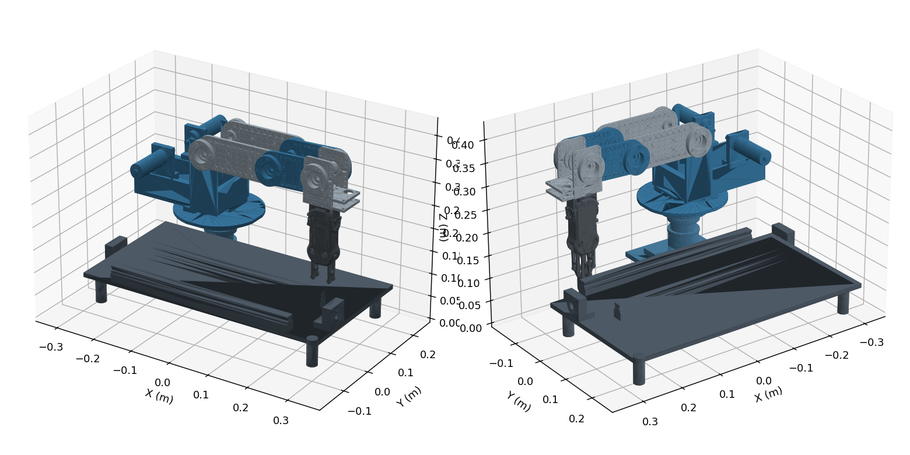

# PIEAS Arm Robotics Lab

[Project overview](../README.md) · [Setup](START_HERE.md) · [Code guide](docs/CODE_GUIDE.md) · [Results](EXPERIMENTS.md) · [Roadmap](docs/ROADMAP.md)

I built this workspace to extend my bachelor's arm project from embedded joint control into perception and motion planning. The work developed in five stages, with a separate ROS package for each responsibility.

This image is an offline model rendering. Runtime observations are recorded separately in the experiment log.

## 1. Robot description and simulation

The first step was recovering the arm from the original CoppeliaSim/V-REP scene. This produced the meshes, joint transforms and robot description. The Gazebo launch adds the controller interfaces and assembles the robot into the startup world so a world reset does not simply remove a model spawned later.

Package: [pieas_arm_description](src/pieas_arm_description/README.md).

## 2. Joint commands and feedback

The next step was sending timed joint goals and checking the resulting position feedback. This established how the action client, trajectory controller and Gazebo connect. A later full-range sweep exposed an important limitation: joint limits alone do not prevent links from colliding. That sweep is retired and its executable refuses motion.

Package: [pieas_arm_control](src/pieas_arm_control/README.md).

## 3. Collision-aware motion and tool targets

MoveIt adds the planning scene, inverse kinematics and collision-checked paths. RViz shows the robot state and planned motion; Gazebo executes the trajectory through the existing controller. The experiments progress from a small joint goal to obstacle avoidance and a tool task that lifts, moves sideways and returns. An optional orientation-constrained mode is also implemented, with its validation status documented separately.

Package: [pieas_arm_moveit_config](src/pieas_arm_moveit_config/README.md).

## 4. Perception and factory sorting

The factory connects an indexed conveyor, RGB-D camera, LiDAR, shape classification, numerical IK and a sorting state machine. A suction-based simulation batch completed six placements, two per shape. This provided an end-to-end baseline for studying perception and manipulation together.

Package: [pieas_sorting](src/pieas_sorting/README.md).

## 5. Apple harvesting

The orchard package adds a scaled trellis, partial leaf occlusion, a small trained appearance classifier and three fruit baskets. RGB-D estimates fruit geometry and LiDAR corroborates the visible surface. The task uses the simulation suction tool, collision-aware approach constraints and basket verification. This package has its own launch and does not change the factory configuration.

Package: [pieas_orchard](src/pieas_orchard/README.md). Runtime evidence and limitations are recorded in its [validation notes](src/pieas_orchard/docs/VALIDATION.md).

## Current status

| Capability | Status |
| --- | --- |
| Model import, controllers and basic motion | Exercised in the local Gazebo setup |
| MoveIt joint goals and XYZ tool sequence | Planned and executed locally |
| Orientation-constrained tool sequence | Implemented; recorded checks are offline |
| Six-object suction sorting | Completed in a reported local run; historical CI results are linked in the factory validation notes |
| Factory with restored original gripper | Current launch configuration; original finger grasping is not implemented |
| Selectable suction/original tools | Planned; no `gripper_type` launch argument yet |
| Camera and LiDAR | Fixed overhead in the factory; fixed robot-base mast implemented in the orchard |
| Apple harvesting | Implemented; see orchard validation for current integration status |
| Dynamic obstacles, recovery and broader object recognition | Future experiments |

## Setup and reading order

The supported setup is Ubuntu 24.04, ROS 2 Jazzy and Gazebo Harmonic. [START_HERE.md](START_HERE.md) contains installation, environment setup and a launch choice for each stage. One integrated launch runs at a time.

The package READMEs explain purpose, current behaviour and important files. Longer implementation details are linked from those pages. [CODE_GUIDE.md](docs/CODE_GUIDE.md) is the reading order for tracing the system from launch to sensor processing and motion execution.

## Modelling limits

The arm has one prismatic joint and five rotary joints. Source travel, mass, inertia and actuator limits are simulation inputs that still need mechanical validation. Position-interface motion and low model-based FK errors do not establish real motor torque, payload capacity or physical placement accuracy.

The original gripper is one rigid link. The tested factory used a fixed-joint suction approximation. Neither is a validated friction-based finger grasp. The current gripper work is described in the [roadmap](docs/ROADMAP.md).

## Asset provenance

Arm geometry comes from the original PIEAS project scene. That scene credits On Robot ApS for the RG2 gripper CAD. Third-party model rights remain with their respective owners; this repository does not grant a new licence for those assets.

