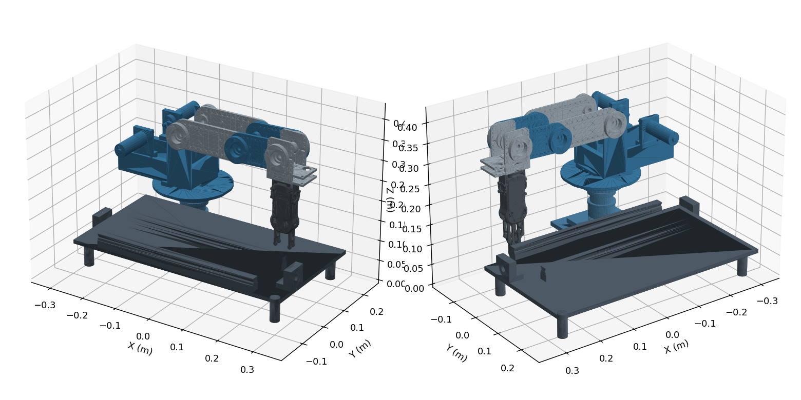

# PIEAS Arm Robotics Lab

A ROS 2 and Gazebo learning and research project built around the six-DOF arm from my bachelor's project at PIEAS. The goal is to progress from controlled joint motion to perception, collision avoidance, and autonomous manipulation.



The preview is an offline mesh rendering. Gazebo runtime validation is the next milestone.

## Current status

| Component | Status |
| --- | --- |
| URDF and eight STL meshes | Extracted, with offline kinematic checks |
| Six arm joints | One sliding joint and five rotary joints |
| ROS 2 control and trajectory controller | Configuration prepared, runtime verification pending |
| Overhead RGB-D camera and 3D LiDAR | World and bridge prepared, runtime verification pending |
| RG2 gripper | Fixed at its saved pose, actuation planned |
| MoveIt planning and perception integration | Planned |
| Autonomous grasping and recovery | Planned |

## Get started

Target environment is Ubuntu 24.04 on amd64 or arm64, with ROS 2 Jazzy and Gazebo Harmonic.

```bash
git clone https://github.com/huzaifazahid888/6DOF_fyp.git ~/6DOF_fyp
cd ~/6DOF_fyp/robotics_lab
bash scripts/setup_ubuntu.sh --yes --build
```

For an existing clone, run `git pull --ff-only` before running the setup script. Run setup as your normal user. It requests sudo for system package installation, configures the official ROS repository if needed, installs missing prerequisites, resolves workspace dependencies, and optionally builds the workspace.

To inspect prerequisites without making changes, run `bash scripts/setup_ubuntu.sh --check`. Add `--with-moveit` when starting the planning stages. Run `--help` for all options.

Setup prints the source and launch commands to run in your current terminal. A successful prerequisite check still requires a Gazebo launch test to verify rendering, physics, and sensors.

Follow [START_HERE.md](START_HERE.md) for the first motion, sensor checks, troubleshooting, and the full experimental roadmap.

## Project files

| Path | Purpose |
| --- | --- |
| START_HERE.md | Setup guide and staged research plan |
| src/pieas_arm_description/urdf | Baseline robot and controller-enabled template |
| src/pieas_arm_description/meshes | Extracted arm and gripper geometry |
| src/pieas_arm_description/config | Controllers and sensor bridge |
| src/pieas_arm_description/launch | Combined simulation launch |
| src/pieas_arm_description/worlds | Gazebo environment and sensor rigs |
| EXPERIMENTS.md | Record settings, outcomes, and reproducible steps |

## Milestones

- [x] Recover the arm geometry and kinematic chain from the V-REP scene.
- [x] Prepare ROS 2 control, sensor world, and launch configuration.
- [ ] Validate Gazebo startup, all joints, and sensor coordinate frames.
- [ ] Integrate MoveIt and verify IK and collision checking.
- [ ] Compare path planners and trajectory generation methods.
- [ ] Estimate object pose using RGB-D data.
- [ ] Build obstacle maps using depth and LiDAR measurements.
- [ ] Implement gripper actuation and physical grasp tests.
- [ ] Complete vision-guided pick-and-place.
- [ ] Add dynamic-obstacle handling and recovery.
- [ ] Evaluate additional sensing and learning-based methods.
- [ ] Publish repeatable benchmark results and a demonstration.

## Development and validation

Build from robotics_lab with colcon. Keep build/, install/, log/, and large experiment recordings out of Git. Record each successful runtime milestone in EXPERIMENTS.md, including the tested commit and software versions. Use a separate branch for each feature and a pull request describing the change and its validation.

Four rotary effort limits are provisional. The slide range and source inertial values require validation. The current position interface supports integration experiments; detailed actuator and payload studies require further modeling.

## Asset provenance

The arm comes from the original PIEAS project scene. The scene credits On Robot ApS for the RG2 gripper CAD. See the package README for conversion details. Third-party model rights remain with their respective owners; this repository does not grant a new license for those assets.
