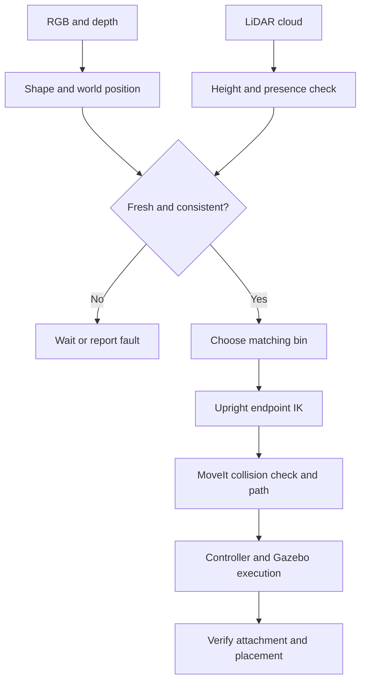

# Read the factory implementation from input to output

## 1. What the application actually does

The earlier tool sequence answered: “Can I put tool0 at these XYZ coordinates?” The factory answers: “What object arrived, where is it, where should it go, and did it get there?” It adds perception and task decisions around the motion planning you already tested.

An indexed conveyor moves a batch of six physical parts. It brakes when its leading part reaches the station. A camera and LiDAR observe that stationary part. The application classifies the visible shape, estimates its pose, picks it with a simulated suction tool, selects the matching bin, and checks placement. A fault interrupts the sequence; a failed command does not silently advance to the next state.

“Intelligent” here means geometric perception, sensor corroboration, decision logic and collision-aware manipulation. It is not a trained neural network, arbitrary-object recognition or reinforcement learning. The controlled object family is three known shapes with a common green surface. This is a complete integration exercise with explicitly bounded perception assumptions.

The two sensor branches meet before motion is permitted:



There are three different kinds of feedback here. Joint states tell us what the arm did. Sensor detections tell us what is on the belt. Machine status tells us whether the belt stopped and whether the simulation attachment exists. A successful command in one branch does not substitute for evidence from another.

## 2. The files and extensions

A `.py` file is Python source. A `.cpp` file is compiled C++ source. A `.yaml` file contains configuration data, not an algorithm. `.sdf` describes a Gazebo world with models, physics and sensors. `.urdf` describes robot links, joints, visuals, collisions and inertias. `.srdf` supplies MoveIt-specific groups and permitted collision pairs. `.rviz` saves visualization settings. `package.xml` declares ROS dependencies; `CMakeLists.txt` tells colcon how to build and install the package.

`scripts/sort_batch` has no filename extension because it is an executable entry point. It imports `pieas_sorting.sorter.main()`. Most of the logic is in the imported Python modules, not in that three-line wrapper.

## 3. Start with the physical layout: cell.yaml and world.py

`cell.yaml` defines the inspection station, belt, bin centres and sensor poses. `world.py::boxes()` returns the same static geometry used by Gazebo and MoveIt. This prevents two separately edited tables from disagreeing about where the belt and bin walls are.

`build_world()` creates an SDF world, lighting, floor, cabinet, belt deck, three open bins, six dynamic parts, camera and LiDAR. Models have both visual and collision shapes. Parts also have mass and inertia. Seeing a green part is a rendering result; supporting it on the deck is a collision/physics result.

The belt deck itself is stationary. `factory_system.cpp` applies bounded horizontal forces to parts resting in the belt region, approximating conveyor traction. It does not teleport parts along a scripted path. Gravity, support contact and the released object's fall remain simulated. It is not a roller-by-roller belt model and has not been calibrated to a physical conveyor's friction.

The plugin indexes from the leading part's simulator position, equivalent to a simplified machine indexing sensor. That position is not published to perception and is not used to choose a shape or pickup point. A real implementation would replace indexing with encoder/photoelectric sensor logic.

Queued parts occupy a conservative MoveIt keepout volume upstream of the station. The active part uses its measured geometry. The keepout is a planning exclusion, not an extra physical wall in Gazebo.

## 4. Why a suction tool replaces the old RG2 geometry

The saved RG2 consists of one rigid visual/collision model. There are no finger joints or finger actuator commands. Claiming it can close and physically grip would be incorrect.

`robot_variant()` creates a temporary URDF with a shaft and circular suction cup on `rg2_link`. The arm joints and `tool0` transform remain exactly the same. It supplies a new tool mass/inertia consistent with a light simulation tool. Both Gazebo and MoveIt receive this same description. Your original URDF remains unchanged.

At the pickup point, `factory_system.cpp` checks the tool's lateral distance, height, upward tool axis and the part's speed. Only then does `grip` create a Gazebo `DetachableJoint` of type `fixed` between the suction link and the part. The joint carries the part's simulated mass. `release` removes it, allowing gravity to act freely.

This approximates a vacuum seal. It does not model vacuum pressure, leakage, maximum holding wrench or flexible cup contact. It also does not use object teleportation to fake a pickup. A real gripper interface must replace this plugin before hardware deployment.

## 5. What the sensors publish

The RGBD camera is one sensor that publishes RGB, depth and camera calibration. Depth is in metres. LiDAR publishes an independent 3D point cloud. These are rendered sensor outputs generated by Gazebo, not lists of model names.

`bridge.yaml` maps Gazebo Transport messages to ROS messages. For example, Gazebo's image message becomes `sensor_msgs/Image`. It also bridges command and machine-status topics. The bridge translates transport/types; it does not classify objects, plan motion or automatically copy objects into MoveIt's scene.

The camera optical frame uses X right, Y down, Z forward. The Gazebo camera link uses a different axis convention. `sensor_transform()` includes the optical-frame rotation, then the known mount pose to world. The static TF publishers in the launch use the same mount geometry. LiDAR points use the LiDAR link frame and its own world transform.

## 6. From image pixels to a measured object

Read `perception_core.py::project()` first. The pinhole equations are:

```
Xcamera = (u - cx) * depth / fx
Ycamera = (v - cy) * depth / fy
Zcamera = depth
Pworld  = Rworld_camera * Pcamera + Tworld_camera
```

The focal lengths and principal point come from CameraInfo. Depth is the optical Z coordinate, not the slanted range along the pixel ray. The transformed world Z minus the known belt height estimates object height.

`detect()` restricts observations to the inspection region and valid height range, then separates the common green foreground from the belt and arm. Every class has the same colour; colour selects foreground, while silhouette geometry selects the class. The classifier examines the contour, its area, fitted rectangle, aspect ratio, polygon corners and circularity:

- Approximately square four-corner silhouette → cube in this known object family.
- Elongated four-corner silhouette → rectangular block.
- Approximately circular silhouette → upright cylinder.
- Ambiguous, clipped, merged, tiny or out-of-range shape → no accepted detection.

A single top view cannot universally distinguish a cube from every possible square prism, or a cylinder from every round-topped object. The known part family and measured height are essential assumptions.

The top surface's median depth gives a robust height estimate. The image centroid is projected to world XY. The contour gives footprint dimensions and yaw. The object centre is halfway down its measured height from its top surface.

## 7. Why LiDAR is involved

The camera provides the class. LiDAR supplies independent evidence that an elevated object exists at the corresponding footprint. `detect()` selects nearby LiDAR points above the deck and checks their median top height against the RGBD estimate. Too few points or a height disagreement rejects the candidate.

This is a consistency gate, not a Kalman filter or a claim that both sensors independently classify the object. The LiDAR is not a certified safety scanner and no automatic 3D environmental mapping is claimed.

`perception.py` checks timestamp freshness and RGB/depth/LiDAR alignment. `Stability` requires four independent frames with the same class and less than 2 mm centroid change between successive frames. Repeated callbacks on one frame do not count as new observations. The stationary indexed belt makes this a suitable first perception-to-manipulation task.

## 8. How the joint angles are found now

The earlier `tool_sequence` still uses MoveIt's KDL IK service and is unchanged. The factory adds `kinematics.py` because a suction cup needs a position and an upright axis, but does not need a fixed yaw. Fixing all three orientation angles would unnecessarily constrain this particular arm.

`Kinematics` reads the generated URDF and builds the chain from world to tool0. `forward(q)` multiplies each joint origin transform by its variable prismatic translation or revolute rotation. The configuration vector is **one rail displacement in metres and five rotary angles in radians**.

`candidates()` uses SciPy bounded nonlinear least squares. Its residual is the XYZ error together with the difference between the tool's +Z direction and world +Z. A 0.15 m weighting balances directional error with position error; acceptance then separately checks position and orientation. Matching a unit direction supplies two independent constraints. Yaw remains free.

The solver starts with the current joint configuration and then deterministic alternative seeds. Each result must satisfy the factory operating envelope, less than 0.8 mm position residual and less than 0.04 rad axis tilt. These are numerical model checks, not hardware accuracy claims. An unreachable target produces no candidate; the code does not silently clamp it into a different target.

The solver does not know collision geometry. `Sorter.move()` passes each candidate to MoveIt's state-validity service. A candidate rejected for self-collision, bin contact or carried-object collision is discarded. A valid endpoint is then passed to the existing `plan_targets()` action client. OMPL finds a path between the actual start joints and goal joints; MoveIt time-parameterizes it using the configured velocity/acceleration limits. Endpoint IK and path planning are separate operations.

The tool is upright at pickup and release endpoints. Transport paths may rotate the sealed payload; suction's rigid attachment can support that in this surrogate. No promise is made that all transit segments are straight Cartesian lines or remain perfectly upright. The carried object's collision geometry follows the tool throughout planning.

## 9. Read the task in execution order

The entry path is `scripts/sort_batch → main() → Sorter.__init__() → Sorter.run()`.

Initialization sets up subscriptions, command publication, a heartbeat timer and ROS clients inherited from `ToolSequence`/`Planner`. `run()` checks the execute parameter, waits for the simulator backend, stops the belt, loads the current robot description, installs the cell scene and checks measured joint feedback. It also compares its own FK with MoveIt's FK to catch frame/model disagreement.

The robot first parks away from the camera footprint. Each cycle then follows:

1. **INDEX_BELT:** request belt motion; wait for indexing to stop at the station.
2. **DETECT_AND_CLASSIFY:** wait for one fresh, stable, LiDAR-corroborated camera detection.
3. **APPROACH_PICK:** add measured part geometry to MoveIt; plan above it.
4. **DESCEND_TO_PICK:** plan to the measured top surface with the tool upright.
5. **ATTACH_SUCTION:** request simulator attachment and require acknowledgement.
6. **LIFT_PAYLOAD:** attach the corresponding collision object to the MoveIt robot and lift it.
7. **TRANSFER_TO_CLASS:** select the bin by shape and plan with the payload included.
8. **LOWER_TO_BIN:** reach an upright release pose above the bin.
9. **RELEASE:** remove the simulator joint and MoveIt attachment.
10. **RETRACT:** move the tool clear, then verify the released object's position is inside the intended bin.
11. Record the result and return to the inspection park pose.

Each bin has two separate drop positions. On the supplied batch, six cycles fill them. Partial-batch resume and emptying bins are not implemented: restart the launch for a new batch.

## 10. Collision state changes are part of the task

The part is initially a world collision object. Only contact with the suction link is permitted during pickup. After gripping it becomes an attached collision object, so MoveIt checks its swept volume along with the arm. Temporary part-to-belt contact is permitted only for initial lift and then revoked.

After release the part becomes a world object again. Once the tool has retracted and placement is verified, the temporary suction-contact permission is revoked; every robot link must avoid that placed part during later cycles. The final position used to update the planning scene is simulator ground truth from the release verification channel. This is explicitly a simulation scoring/scene-maintenance mechanism, not camera perception. A deployed cell would use a bin sensor or a second view to verify placement.

World-to-world object collision is Gazebo's job. MoveIt checks the robot and its carried geometry against the scene; it is not the physics engine that makes released parts fall.

## 11. Failures, logs and what to inspect

The application stops on stale data, unknown shapes, missing LiDAR support, IK failure, invalid robot states, rejected plans, controller failure or failed attachment. It does not advance the state machine because a delay elapsed. Requests use timeouts; Ctrl+C requests cancellation. If carrying an object, failure keeps the attachment rather than automatically dropping it.

The Gazebo plugin requires a heartbeat to keep the belt running. This is a software watchdog for the simulated machine, not a real emergency-stop circuit. During motion, the task watches simulator/joint feedback and attachment status. On reset it requires a clean relaunch.

Read `/factory/task_state` to see the current task phase, `/factory/detections` for perception acceptance/rejection, and `/factory/state` for belt/attachment status. Review CSV records for completed placements. A scene displaying correctly is not equivalent to a successful batch.

## 12. Hardware boundary

Camera calibration and transforms must be measured on a real cell. The simulation backend would be replaced by a conveyor PLC/motor interface and a real gripper command/status driver. The ROS controller backend would be replaced by your motor/encoder hardware interface. Shape perception and the task state machine could remain structurally similar, but timing, payload limits, joint limits, collision geometry and failure handling require commissioning.

Your STM32/CAN experience fits precisely at that boundary: the PC chooses task goals and planned trajectories; embedded firmware runs deterministic actuator control, reports measured state and enforces local limits. The simulator is currently substituting for that machinery.
